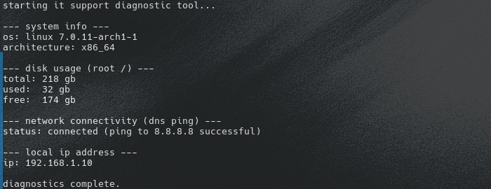

## Support Diagnostics Tool

A lightweight CLI tool designed for quick, automated system and network diagnostics. Built entirely with Python's standard library, requiring no external dependencies.

### Current Features

The script performs automated checks to assist with troubleshooting:
* **System Info:** Retrieves basic operating system and architecture details.
* **Disk Usage:** Calculates total, used, and free space on the root drive.
* **Network Connectivity:** Verifies internet access by pinging Google's DNS (8.8.8.8).
* **Local IP:** Resolves and displays the machine's local IP address on the network.

### How to run

- Open the terminal in the project folder.
- Run the script directly (no virtual environment or external libraries required): 
   `python3 diag.py`

